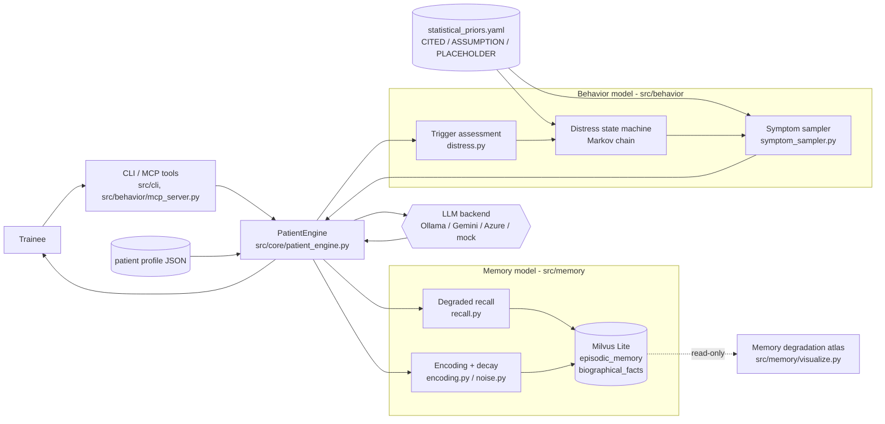

# Late-Stage Dementia Simulation

**An open-source research framework for generating clinically-plausible synthetic dementia
behavior (GDS/FAST stages 5-7) with an LLM, for caregiver and clinician training.** The patient
is not a prompt with a persona: speech, emotion and *memory* are each driven by separate,
inspectable, literature-anchored models, and every number that shapes a generated reply is
traceable to a source or explicitly labelled as an assumption.

> **Read this first: scientific status.** This is a simulation and engineering study, not a
> clinical validation. Of the 15 stage-level behavior priors, **1 is literature-cited, 8 are
> assumptions anchored to a paper's direction or scale, and 6 are placeholders** (run
> `python -m cli.app priors-status`). Memory-noise magnitudes are tuning constants. Do not
> make a clinical or research claim from generated output until every prior is cited. See
> [Evidence and provenance](#evidence-and-provenance).

## Contents

1. [Why this exists](#why-this-exists)
2. [Clinical background](#clinical-background)
3. [System architecture](#system-architecture)
4. [The communication sequence](#the-communication-sequence)
5. [Patient memory model](#patient-memory-model)
6. [Behavior model](#behavior-model)
7. [Evidence and provenance](#evidence-and-provenance)
8. [Evaluation and results](#evaluation-and-results)
9. [The memory degradation atlas](#the-memory-degradation-atlas)
10. [Demo walkthrough](#demo-walkthrough)
11. [Quickstart](#quickstart)
12. [Running checks locally](#running-checks-locally) · [Evaluation suite](#running-the-evaluation-suite) · [Project layout](#project-layout)
13. [Limitations and ethics](#limitations-and-ethics)
14. [References](#references)

## Why this exists

Caregivers of people with advanced dementia are rarely trained on realistic practice partners:
real patients are vulnerable, and scripted role-play actors cannot reproduce the *shape* of
cognitive decline. A plain LLM prompted to "act demented" tends to fail in telling ways: it
stays too fluent, forgets uniformly instead of in the clinically observed pattern, and cannot
be audited. This project asks a narrower, testable question:

> Can an LLM be **constrained turn-by-turn** by an explicit memory model and behavioral priors so
> that the *mechanisms* of decline (retrieval failure, confabulation, anomia, distress) are
> reproducible, tunable and inspectable, instead of an emergent property of a prompt?

The answer this repository provides is an architecture (memory in a vector store with explicit
degradation processes, behavior sampled from priors, an LLM that only verbalizes the result),
an evaluation harness, and a provenance system that makes the weak points visible rather than
hiding them.

## Clinical background

Stages follow Reisberg's **Global Deterioration Scale (GDS)** and **Functional Assessment
Staging (FAST)**. This project covers the three latest stages:

| Stage | GDS / FAST label | Defining features modelled here |
|---|---|---|
| 5 | Moderately severe decline | Major recall gaps; still speaks in sentences; occasional naming errors. |
| 6 | Severe decline | Misidentifies familiar people; increasing dependence; behavioral and emotional disturbance. |
| 7 | Very severe decline | Speech reduced to a few words or none (FAST 7a: fewer than six intelligible words per day; 7b: one word); non-verbal communication dominates. |

Two well-documented memory phenomena motivate the memory design:

- **Temporal gradient / Ribot's law.** Remote autobiographical memories are relatively
  preserved while recently formed memories are lost first. The recall model weights memories
  by era to reproduce this (see [Patient memory model](#patient-memory-model)).
- **Anterograde failure and confabulation.** New experiences are increasingly not stored at
  all, and what is stored or recalled can be distorted (wrong person, number or relation). The
  encoder and the retrieval-noise model reproduce both.

## System architecture



Design principles:

- **Mechanisms are separate from language.** Behavior and memory are decided by deterministic,
  seeded code. The LLM only verbalizes the decision, and a post-processor enforces the hard
  constraints (word cap, required non-verbal cue) so they hold even if the model ignores them.
- **No hard-coded numbers.** `symptom_sampler.py` reads every prior from
  `config/statistical_priors.yaml`, so updating a citation is a config change, not a code change.
- **Reproducible.** All noise draws from one injected `numpy` RNG (`--seed`).
- **Offline by default.** The `mock` LLM and the `hashing` embedder need no network or model
  download, so the whole pipeline runs in tests and on a laptop.

## The communication sequence

One trainee utterance flows through the simulator as follows (this is exactly what the
[atlas replay](#the-memory-degradation-atlas) animates, step by step):

```mermaid
sequenceDiagram
    autonumber
    participant T as Trainee
    participant E as PatientEngine
    participant D as Distress model
    participant S as Symptom sampler
    participant R as Memory recall
    participant V as Milvus Lite
    participant L as LLM
    participant N as Encoder

    T->>E: utterance
    E->>D: evaluate_trigger(utterance)
    D-->>E: sensitive topic? pressuring? redirection?
    E->>D: transition(assessment)
    D-->>E: next distress state (calm / confused / agitated / withdrawn)
    E->>S: sample_constraints(stage, state, priors)
    S-->>E: max_words, non-verbal cue, memory_fog, factual_inversion, anomia, escalation
    alt memory_fog
        E->>E: skip recall (nothing surfaces)
    else normal turn
        E->>R: recall(utterance) for episodes and facts
        R->>V: vector search (cue + noise)
        V-->>R: nearest candidates
        R-->>E: hits attenuated by era, decay, rehearsal; maybe swapped / substituted
    end
    E->>E: build_system_prompt(persona, state, rules, degraded memories)
    E->>L: generate(system prompt, recent history)
    L-->>E: raw reply
    E->>E: post-process (hard word cap, required cue)
    E->>N: encode_episode(utterance) (may fail or be garbled)
    N->>V: insert new memory
    E-->>T: patient reply + debug panel
```

1. **Trigger assessment** (`behavior/distress.py`): lexical heuristics flag sensitive topics
   from the profile, pressuring language ("don't you remember?") and redirection language
   (validation, gentle topic change).
2. **Distress transition**: a row-stochastic Markov matrix over `calm / confused / agitated /
   withdrawn` is reweighted by those flags, then sampled.
3. **Symptom sampling** (`behavior/symptom_sampler.py`): a truncated-normal word budget plus
   Bernoulli draws for non-verbal cue, memory fog, factual inversion, anomia and distress
   escalation, each modulated by the distress state.
4. **Memory recall** (`memory/recall.py`): vector search with cue noise, then attenuation and
   noise injection (details below). Skipped entirely on a "memory fog" turn.
5. **Prompt assembly**: persona, family, current state, this turn's rules and the *degraded*
   memories. The model never sees the clean original; hazy or uncertain fragments are tagged so
   they are conveyed loosely.
6. **Generation and post-processing**: the LLM replies, then a hard cap and the required
   non-verbal cue are enforced.
7. **Encoding**: what the trainee said becomes a new episodic memory unless encoding fails;
   what is stored may already be garbled. This is how the patient's memory changes over a session.

## Patient memory model

Two Milvus Lite collections hold the memory (`src/memory/client.py`): `episodic_memory`
(autobiographical episodes with era and emotional valence) and `biographical_facts` (discrete
facts). Records are 384-d unit vectors (`COSINE` metric). A record that has been degraded keeps
its ground truth in `original_text` / `original_fact`, so evaluation can always tell what the
patient *should* have remembered versus what is stored.

### Mechanisms

| Mechanism | Where | Effect |
|---|---|---|
| Era retention (Ribot's law) | `recall.py` | Remote memories (childhood) keep their similarity score; recent ones are attenuated, more steeply at later stages. |
| Time decay + rehearsal | `recall.py` | Conversation-formed memories decay with real elapsed time; successful retrievals increment `access_count` and give a small, capped boost. |
| Cue noise | `recall.py` | The query vector is perturbed, so a good cue can still miss. |
| Retrieval swap | `recall.py` | With stage-dependent probability the top hit is replaced by a neighboring memory (`noise_type="swap"`). |
| Retrieval substitution | `recall.py` / `noise.py` | Names, relations and numbers in the surfaced text are altered (e.g. Susan -> Ellen, 28 -> 31). |
| Encoding failure | `encoding.py` | A new experience is not stored at all, with probability rising from stage 5 to 7. |
| Encoding corruption | `encoding.py` | What is stored is already garbled; the clean text is kept in `original_text`. |
| Decay pass | `encoding.py` | `age-memory` permanently corrupts a stage-scaled fraction of stored records and re-embeds them, so the vectors drift with the content. |

### Equations

For a candidate memory with cosine similarity `s` to the (noisy) cue, the attenuated score used
for ranking is

```
score = s * w_era(stage, age) * exp(-lambda_stage * t) * min(1.25, 1 + 0.05 * ln(1 + access_count))

w_era = floor_stage + (0.95 - floor_stage) * (1 - exp(-0.05 * age_years))
```

`age_years` comes from the era tag (childhood 70, young adult 55, adulthood 35, career 20, late
adulthood 5, recent conversation 0.1). A swap fires with probability `anomia_rate * 0.5` for
episodes and `factual_inversion_rate` for facts; substitution fires at half that rate.

### Stage parameters

| Parameter | Stage 5 | Stage 6 | Stage 7 | Meaning |
|---|---|---|---|---|
| `floor_stage` (recent-memory retention) | 0.55 | 0.35 | 0.15 | How much of a *recent* memory's score survives |
| `lambda_stage` (per second) | 1e-6 | 3e-6 | 8e-6 | Time-decay rate for conversation memories |
| Encoding failure probability | 0.25 | 0.50 | 0.80 | New experience never stored |
| Encoding corruption severity | 0.2 | 0.4 | 0.6 | Share of eligible tokens altered when stored |
| Decay-pass fraction | 0.10 | 0.25 | 0.40 | Records touched per `age-memory` pass |
| Vector noise sigma | 0.05 | 0.10 | 0.20 | Perturbation of a corrupted record's embedding |

These are **simulation placeholders, not clinical measurements**; they live in `NoiseConfig`
(`src/memory/noise.py`) and at the top of `recall.py`. Each returned `MemoryHit` carries
`confused`, `noise_type` (`swap`, `substitution`, `swap+substitution`, `stored_corruption`, or
`None`) and `original_text` when the ground truth is known.

**Reproducibility.** Seeded profile memories are stored clean; persistent corruption only occurs
through conversation encoding and explicit `age-memory` runs. **Embedding dimension.** The store
is created with the embedder's dimension; opening it with a different embedder raises a clear
error, so run `reset-memory` (or use a new `--db-path`) after switching.

## Behavior model

Per-turn behavior is sampled from the priors in `config/statistical_priors.yaml`:

| Prior | Stage 5 | Stage 6 | Stage 7 | Provenance |
|---|---|---|---|---|
| Words per turn (mean, max) | 45, 90 | 22, 55 | 1, 5 | ASSUMPTION (stage 7 max is the cited FAST 7a bound) |
| Anomia rate | 0.305 | 0.50 | 0.75 | **CITED** (stage 5), ASSUMPTION (6-7) |
| Non-verbal cue probability | 0.15 | 0.35 | 0.65 | PLACEHOLDER |
| Factual inversion rate | 0.18 | 0.35 | 0.55 | PLACEHOLDER |
| Distress escalation probability | 0.10 | 0.22 | 0.30 | ASSUMPTION |

The distress state then scales these (for example an agitated patient has 1.8x the escalation
probability and 0.7x the word budget; a withdrawn one has 0.4x the words). The state machine's
transition matrix is an assumption whose stationary agitated share (19.5%) falls inside the
13-24% prevalence range reported by Steinberg et al. (2008), which is a consistency check, not a
fit.

## Evidence and provenance

Every prior's `source` field starts with one of three labels, and tooling enforces it:

| Label | Meaning | Count |
|---|---|---|
| `CITED` | The number comes from a study (extraction notes in `research/extracted/`) | 1 |
| `ASSUMPTION` | A modeling choice; the literature supports direction or rough scale only | 8 |
| `PLACEHOLDER` | No source found yet | 6 |

- `python -m cli.app priors-status` prints the table and **exits 1 while any prior is not CITED**.
- `pytest -m research_gate` fails for the same reason (deselected from the default run).
- `tests/test_priors_provenance.py` requires every `CITED` value to have an extraction note.
- `research/extraction_log.csv` records every extracted number with page/table, population,
  DOI and how it was derived; `research/extracted/CHANGELOG.md` records each change.

**What the literature review actually supported** (full notes in `research/extracted/`):

| Source | What it gave this project | What it could *not* give |
|---|---|---|
| Silagi et al. 2015 (Boston Naming Test in AD) | The one cited value: stage 5 anomia = 30.5% (moderate AD, any naming error) and the mild-to-moderate trend used to extrapolate | Any data below MMSE 12, so stages 6-7 are extrapolations |
| Hoffmann et al. 2010 (speech tempo in AD) | Direction: slower speech and more hesitation with severity | Words per turn (it reports phonemes/s); moderate vs severe did not differ significantly |
| Mitchell 2015 (NEJM, advanced dementia) | The FAST 7a/7b bound (under six intelligible words/day) used as the stage 7 word ceiling | Per-turn distributions |
| Steinberg et al. 2006 / 2008 (Cache County) | Agitation odds ratio 2.42 per CDR point; 13-24% monthly prevalence, anchoring the escalation priors and transition matrix | Per-turn probabilities; stage-specific values |
| Bender et al. 2022 (scoping review) | Reviewed; care-partner strategies only | Any patient non-verbal rates (non-verbal prior stays a placeholder) |

A deliberate decision recorded in the changelog: stage 7 fluency was **lowered** (mean 6 to 1,
max 20 to 5) because the old value contradicted the project's own FAST staging. The simulated
stage 7 patient is therefore nearly mute by definition; revert it if conversational usability
matters more than FAST fidelity for an experiment. Open gaps: late-stage speech output,
stage-specific confabulation/misidentification rates and non-verbal cue frequency.

## Evaluation and results

Everything below runs offline and is deterministic per seed.

| Harness | What it measures |
|---|---|
| `evaluation/run_benchmarks.py` | 20 fixed trainee dialogues (10 validating, 10 pressuring) x 3 stages = 60 runs, recording word counts, distress states and constraints per turn |
| `evaluation/consistency_checker.py` | Factual/persona consistency against a 90% retention target |
| `evaluation/memory_benchmark.py` | Per-stage top-1 *faithful* recall over every biographical fact |
| `evaluation/generate_charts.py` | Publication-ready charts: word count by stage, distress transition heatmap, consistency vs turn depth |

**Memory-layer benchmark** (`python evaluation/memory_benchmark.py`, seed 0, 400 queries per
stage, hashing embedder). A query is the fact's own text; "faithful" means the top hit is the
intended fact and was neither swapped nor altered:

| Stage | Top-1 faithful | Noise rate | Mean top-1 score |
|---|---|---|---|
| 5 | 0.79 | 0.21 | 0.877 |
| 6 | 0.55 | 0.46 | 0.732 |
| 7 | 0.37 | 0.63 | 0.623 |

Faithful recall falls monotonically with stage and noise rises, as designed. **What this does and
does not show:** it verifies the implementation behaves as specified and is monotone in stage;
because the noise parameters are tuning constants, it is *not* evidence that the simulated
degradation matches real patients. Validating that needs clinician ratings or comparison to
human data, which is future work.

## The memory degradation atlas

`memory-map` renders a self-contained, **read-only** HTML report of the patient's whole memory
store: the primary tool for inspecting, demoing and explaining the memory model. It makes no
network requests (Pico.css and Plotly are inlined), never modifies the store, never bumps
`access_count` and never calls an LLM.

```bash
python -m cli.app memory-map --stage 7 \
    [--query "tell me about your garden"] \
    [--transcript transcripts/<session>.json] \
    [--projection tsne|pca] [--out path.html] [--open]
```

Default output: `evaluation/plots/memory_map_stage{N}.html` (gitignored; the file is ~5 MB
because Plotly is embedded).

**What you see**

- **Layout.** Each memory is a point, placed by t-SNE (or PCA) so semantically similar memories
  are near each other. Memories are grouped into clusters drawn as a hub with spokes and a red
  label naming the most representative memory and the group size.
- **Degradation drift.** For every corrupted record, the ground truth (`original_text`) is
  re-embedded with the store's own embedder and an amber arrow is drawn from where the memory
  *should* sit to where the degraded vector *actually* sits. Cosine drift is `1 - cos(original,
  stored)`; hover for the value and the corruption operations (substitution, dropout, numeric
  drift).
- **Encodings.** Squares are episodes, diamonds are facts; amber = degraded, brighter = recalled
  more often (rehearsal), larger = more corrupted.
- **Query.** `--query` places a green star with dotted lines to its 3 nearest memories.
- **Communication sequence.** `--transcript` adds a step-through replay of a recorded
  conversation (below).

**Interactivity.** Hover any point, hub, arrow or star for a plain-language explanation.
Layer toggles show or hide episodes, facts, clusters, drift arrows, the query and the replay.
The control bar offers zoom in/out, reset, a pan mode, fullscreen and PNG export, and the mouse
wheel zooms. The page is a self-contained *snapshot*: the data, query and conversation are fixed
when the file is generated, which keeps it offline and shareable. It is not a live app.

**Reading the layout correctly.** In t-SNE, distances *within* a cluster are meaningful, but the
axes and the gaps between far-apart clusters are not. Inputs under 5 points fall back to PCA,
and `--projection pca` gives a linear view whose axis titles show explained variance. The map
is richer with more memories (`add-memory`, `age-memory`, or a longer chat).

### Replaying a conversation

`chat` saves a JSON transcript of every session (including memory hits and sampled
constraints). Replay it on the map:

```bash
python -m cli.app chat --backend mock --db-path demo.db --seed 3     # records transcripts/<session>.json
python -m cli.app memory-map --stage 7 --db-path demo.db --transcript transcripts/<session>.json --open
```

The **Communication sequence** panel steps through the eight stages of a turn (trainee
utterance, trigger assessment, symptom sampling, memory recall, prompt assembly, LLM
generation, post-processing, encoding), showing the real sampled values for that turn. At the
recall step the cue appears as a cyan star and the retrieved memories light up as rings
(green = faithful, amber = already degraded, red = noise injected at retrieval). Use
Back/Play/Next, a 0.5x-3x speed selector, a clickable progress bar, the turn buttons, or the
left/right arrow keys.

Use the *same* `--db-path` for the chat and the map: hits are matched to points by record id
(falling back to text), so a different database will not line up. The atlas needs a non-empty
store; run `seed-memory` or `age-memory` first.

## Demo walkthrough

A five-minute script for a showcase (all offline, no API key):

```bash
# 1. Fresh store, then simulate disease progression so there is degradation to see
python -m cli.app reset-memory --yes --db-path demo.db
python -m cli.app age-memory --stage 7 --passes 3 --seed 7 --db-path demo.db

# 2. Show the text-only evidence: what survived, what was corrupted
python -m cli.app memory-stats --db-path demo.db
python -m cli.app recall "tell me about your garden" --stage 7 --db-path demo.db

# 3. Hold a short conversation (mock LLM), then replay it on the map
python -m cli.app chat --backend mock --db-path demo.db --seed 3
python -m cli.app memory-map --stage 7 --db-path demo.db \
    --query "tell me about your garden" --transcript transcripts/<latest>.json --open

# 4. Show the research backbone
python -m cli.app priors-status
python evaluation/memory_benchmark.py
```

Suggested narrative: *(a)* hover points to show intact vs degraded engrams; *(b)* toggle
"Drift arrows" to show how far each corrupted memory has moved from its truth; *(c)* step
through the Communication sequence on one turn to show how a single utterance becomes a
degraded recall and then a constrained reply; *(d)* end on `priors-status` to be upfront about
which numbers are cited and which are assumptions.

**WSL note.** `--open` relies on a Linux browser handler. In WSL, open the file in your Windows
browser instead, e.g. `explorer.exe "$(wslpath -w evaluation/plots/memory_map_stage7.html)"`,
or `"/mnt/c/Program Files/Google/Chrome/Application/chrome.exe" "$(wslpath -w <file>)"`.

## Quickstart

### 1. Install Miniforge3

If you don't already have a conda distribution, install
[Miniforge3](https://github.com/conda-forge/miniforge) (a minimal,
community-maintained conda installer that defaults to the conda-forge
channel):

```bash
curl -L -O "https://github.com/conda-forge/miniforge/releases/latest/download/Miniforge3-$(uname)-$(uname -m).sh"
bash Miniforge3-$(uname)-$(uname -m).sh
```

Restart your shell after installation so `conda` is on your `PATH`.

### 2. Create the environment

From the repository root:

```bash
conda env create -f environment.yml
conda activate dementia-sim
```

If you already have an environment named `dementia-sim`, update it instead:

```bash
conda env update -n dementia-sim -f environment.yml
conda activate dementia-sim
```

### 3. Install pre-commit hooks

Immediately after activating the environment, install the git hooks so
`detect-secrets`, `ruff`, and `mypy` run automatically before every commit:

```bash
pre-commit install
```

The repository already ships a `.secrets.baseline` (see
`.pre-commit-config.yaml`). If `detect-secrets` flags a new finding you've
verified is safe, update the baseline with:

```bash
detect-secrets scan --baseline .secrets.baseline
```

You can run all hooks manually at any time with:

```bash
pre-commit run --all-files
```

This project intentionally does not use a cloud CI service. `pre-commit`
running locally (detect-secrets + ruff + mypy) plus `pytest` locally is the
whole "CI" story -- see [Running checks locally](#running-checks-locally)
below.

### 4. Initialize Milvus Lite memory

Milvus Lite needs no separate server -- it's a local embedded database file
created on first use. Seed it from the default patient profile:

```bash
python -m cli.app seed-memory
```

This creates `./milvus_patient_memory.db` and populates the
`episodic_memory` and `biographical_facts` collections from
`config/patient_profiles/stage7_late.json`.

Try the memory layer directly (no LLM needed):

```bash
python -m cli.app recall "tell me about your garden" --stage 7   # degraded lookup
python -m cli.app add-memory "Susan brought lilies" --stage 6    # may fail / be garbled
python -m cli.app age-memory --stage 7 --passes 2                # permanent decay
python -m cli.app memory-stats
python -m cli.app memory-map --stage 7 --query "tell me about your garden"   # interactive atlas (HTML)
python -m cli.app reset-memory --yes                             # wipe + re-seed
```

### 5. (Optional) Pull an Ollama model for local inference

Install [Ollama](https://ollama.com), then pull a small local model:

```bash
ollama pull llama3.2:3b
# or
ollama pull mistral
```

### 6. (Optional) Configure Gemini

Copy `.env.example` to `.env` and set `GEMINI_API_KEY` (get one at
https://aistudio.google.com/apikey). Never commit `.env`.

```bash
cp .env.example .env
```

### 6b. (Optional) Configure Azure OpenAI (Azure AI Foundry)

Create an Azure OpenAI resource and deploy a chat model (e.g.
`gpt-4.1-mini`) in [Azure AI Foundry](https://ai.azure.com), then set
`AZURE_OPENAI_API_KEY`, `AZURE_OPENAI_ENDPOINT`, `AZURE_OPENAI_DEPLOYMENT`
(the deployment name, not the base model name), and
`AZURE_OPENAI_API_VERSION` in `.env`. Never commit `.env`.

Azure currently issues two different endpoint shapes depending on how the
resource was created -- a classic per-resource endpoint
(`https://<resource>.openai.azure.com`) and a newer Azure AI Foundry
project endpoint (containing `/openai/v1`, e.g. `.../openai/v1/responses`).
Paste whichever one your resource gives you into `AZURE_OPENAI_ENDPOINT`
as-is; the backend detects which API shape it is and talks to it
correctly either way.

Whichever backend you configure, verify credentials and connectivity
before starting a full session:

```bash
python -m cli.app test-connection --backend ollama
python -m cli.app test-connection --backend gemini
python -m cli.app test-connection --backend azure
```

Each sends one minimal prompt and reports success/failure with latency,
without touching memory or the patient profile.

### 7. Run the interactive CLI

```bash
# Fully offline, deterministic mock backend -- no model required:
python -m cli.app chat --backend mock

# Local Ollama:
python -m cli.app chat --backend ollama --model llama3.2:3b

# Gemini:
python -m cli.app chat --backend gemini --model gemini-flash-lite-latest

# Azure OpenAI (deployment name from .env, e.g. gpt-4.1-mini, or pass --model explicitly):
python -m cli.app chat --backend azure
```

Type `quit` or press `Ctrl+C` to end a session; the full transcript is
saved as JSON under `transcripts/`.

By default `chat` also *encodes what the trainee says as new patient
memories* (`--remember`, on by default). At later stages that encoding often
fails or stores a garbled version, and those memories can surface in later
turns. Pass `--no-remember` for a read-only session. Note that memories
persist in the database file across sessions; use `reset-memory` to start
clean.

Other CLI commands:

```bash
python -m cli.app list-profiles
python -m cli.app seed-memory --profile config/patient_profiles/stage7_late.json
```

### 8. Run the MCP tool server

```bash
python -m behavior.mcp_server
```

Exposes `sample_symptom_constraints`, `get_distress_state`,
`transition_distress_state`, `recall_patient_memory`,
`get_patient_biographical_fact`, `store_patient_memory`,
`age_patient_memory`, `get_memory_stats`, and `get_patient_profile_summary`
as MCP tools.

## Running checks locally

Run the full local check suite (this is the project's "CI"):

```bash
pre-commit run --all-files   # detect-secrets, ruff, mypy
pytest                        # unit + integration tests, with coverage
```

## Running the evaluation suite

```bash
# 1. Run 20 fixed benchmark dialogues (10 validation-style, 10
#    pressuring-style) across stages 5, 6, and 7:
python evaluation/run_benchmarks.py --backend mock --model mock

# 2. Check factual/persona consistency against a 90% retention target:
python evaluation/consistency_checker.py

# 3. Generate publication-ready charts into evaluation/plots/:
python evaluation/generate_charts.py

# 4. Benchmark the memory layer: per-stage top-1 faithful recall and noise rate
#    over every biographical fact (offline, deterministic per --seed):
python evaluation/memory_benchmark.py
```

Results land in `evaluation/results/` (`benchmark_results.{json,csv}`,
`consistency_report.json`, `memory_benchmark.json`) and `evaluation/plots/`
(`word_count_by_stage.png`, `distress_transition_heatmap.png`,
`persona_consistency_vs_turn_depth.png`).

## Project layout

```
config/                      Statistical priors + patient profiles
research/                    Literature extraction template, notes (extracted/), log (CSV)
src/
  core/                       Domain models, LLM providers, patient engine, logging
  memory/                     Milvus Lite client, embeddings, degraded recall,
                              noise model, encoding/decay, atlas (visualize.py + assets/)
  behavior/                   Symptom sampler, distress state machine, MCP server
  cli/                        Typer/rich interactive CLI
evaluation/                   Benchmark runner, consistency checker, memory benchmark, charts
tests/                        pytest suite
transcripts/                  Saved CLI session transcripts (gitignored)
logs/                         Rotating loguru logs + prompt traces (gitignored)
```

## Limitations and ethics

- **Not clinically validated.** Most priors are assumptions or placeholders, and the noise
  magnitudes are tuning constants. The atlas and benchmarks demonstrate *mechanism*, not
  fidelity to real patients.
- **Staging mismatch.** Source studies stage by MMSE or CDR, not GDS/FAST, and mostly cover mild
  to moderate disease. Stage 6-7 values are extrapolations.
- **Simple heuristics.** Trigger detection is lexical keyword matching, not clinical NLP. The
  hashing embedder is deterministic but semantically weak; `--embedding-backend
  sentence-transformer` gives richer clusters (needs the `embeddings` extra).
- **Small default store.** The seeded profile has 15 memories, which makes the atlas sparse.
- **Training use, not diagnosis.** Output is synthetic and must not be used to diagnose, or as a
  substitute for supervised clinical or caregiver training. Patients are fictional; the
  persona profile contains no real person's data.
- **Secrets.** Never commit `.env`; `detect-secrets` runs in pre-commit.

## Contributing literature-grounded priors

Each numeric prior in `config/statistical_priors.yaml` carries a `CITED`, `ASSUMPTION` or
`PLACEHOLDER` label in its `source` field. See `research/README.md` for the extraction template
and workflow to promote assumptions and placeholders to cited values;
`tests/test_priors_provenance.py` enforces that a `CITED` value has extraction notes in
`research/extracted/`. The highest-value gaps are late-stage speech output, stage-specific
confabulation rates and non-verbal cue frequency.

## References

- Reisberg, B., Ferris, S. H., de Leon, M. J., & Crook, T. (1982). The Global Deterioration
  Scale for assessment of primary degenerative dementia. *American Journal of Psychiatry,
  139*(9), 1136-1139.
- Reisberg, B. (1988). Functional assessment staging (FAST). *Psychopharmacology Bulletin,
  24*(4), 653-659.
- Ribot, T. (1881). *Les maladies de la memoire.* Paris: Germer Bailliere.
- Silagi, M. L., Bertolucci, P. H. F., & Ortiz, K. Z. (2015). Naming ability in patients with
  mild to moderate Alzheimer's disease: what changes occur with the evolution of the disease?
  *Clinics, 70*(6), 423-428. https://doi.org/10.6061/clinics/2015(06)07
- Hoffmann, I., Nemeth, D., Dye, C. D., Pakaski, M., Irinyi, T., & Kalman, J. (2010). Temporal parameters of spontaneous speech in Alzheimer's disease.
  *International Journal of Speech-Language Pathology, 12*(1), 29-34. https://doi.org/10.3109/17549500903137256
- Mitchell, S. L. (2015). Advanced dementia. *New England Journal of Medicine, 372*(26),
  2533-2540. https://doi.org/10.1056/NEJMcp1412652
- Steinberg, M., Corcoran, C., Tschanz, J. T., Huber, C., Welsh-Bohmer, K., Norton, M. C., et
  al. (2006). Risk factors for neuropsychiatric symptoms in dementia: the Cache County Study.
  *International Journal of Geriatric Psychiatry, 21*(9), 824-830. https://doi.org/10.1002/gps.1567
- Steinberg, M., Shao, H., Zandi, P., Lyketsos, C. G., Welsh-Bohmer, K. A., Norton, M. C., et
  al. (2008). Point and 5-year period prevalence of neuropsychiatric symptoms
  in dementia: the Cache County study. *International Journal of Geriatric Psychiatry, 23*(2),
  170-177. https://doi.org/10.1002/gps.1858
- Bender, E. N., Savundranayagam, M. Y., Murray, L., & Orange, J. B. (2022). Supportive
  strategies for nonverbal communication with persons living with dementia: a scoping review.
  *International Journal of Nursing Studies*, 104365. https://doi.org/10.1016/j.ijnurstu.2022.104365
- van der Maaten, L., & Hinton, G. (2008). Visualizing data using t-SNE. *Journal of Machine
  Learning Research, 9*, 2579-2605.
